<p align="center">
  
</p>

<h1 align="center">Nivasa</h1>

<p align="center"><b>Find a hostel or PG in Pune that fits your whole day: the rent, the commute, the food and the walk to the chemist.</b></p>

<p align="center">
  
  
  
  
  
  
</p>

<p align="center">
  <a href="#june-940-pm-nashik">The problem</a> ·
  <a href="#what-nivasa-does">What it does</a> ·
  <a href="#a-walk-through-the-app">Screens</a> ·
  <a href="#how-nivasa-ranks-a-stay">How it ranks</a> ·
  <a href="#built-on-real-data">Real data</a> ·
  <a href="#architecture">Architecture</a> ·
  <a href="#run-it">Run it</a>
</p>

<p align="center">
  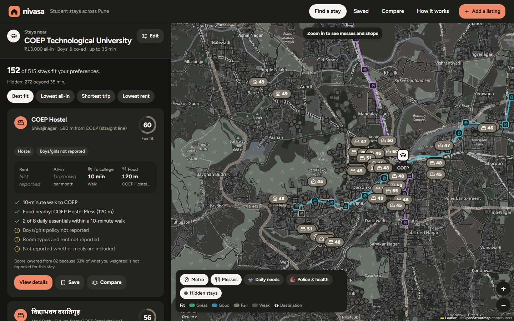
</p>

---

## June, 9:40 pm, Nashik

You have just been admitted to COEP. Classes start in five weeks, you know nobody in Pune, and your family has set a budget of ₹13,000 a month for everything.

The listing sites show you rent. Hundreds of rents. A PG in Aundh looks ₹2,000 cheaper than one in Shivajinagar, so it goes on the shortlist.

What the listing does not say: Aundh to COEP is about 30 minutes by auto-rickshaw, there is no metro station near it, and at Pune's current auto fares that trip costs about **₹8,350 a month**. The "cheaper" PG has no meals, so add roughly **₹2,900** for a mess. Nobody mapped a mess within walking distance. You find all of this out in your second week.

**Nivasa was built for that evening.**

<sub>The scene is illustrative. The figures are what Nivasa reports for a real PG in Aundh mapped on OpenStreetMap, using the fares and mess rates in <a href="docs/METHODOLOGY.md">docs/METHODOLOGY.md</a>.</sub>

### Why rent alone is the wrong number

| Number | What it means |
|---|---|
| **₹2,900** | A month of food when meals are not included: the SPPU member rate of ₹48 per veg meal, twice a day.<sup>[1]</sup> |
| **₹30 + ₹20/km** | Pune auto fare from 1 September 2026. A daily 7 km auto commute is more than many PG rents.<sup>[2]</sup> |
| **₹1,500** | The PMPML monthly pass, which caps what a bus commute can cost.<sup>[3]</sup> |
| **30 %** | Pune Metro student concession, if both ends are near a station.<sup>[4]</sup> |
| **45** | Messes mapped on OpenStreetMap across the whole Pune region. "None mapped" never means "none there". |

The rent is the part of the month a student can see. Nivasa adds up the rest.

## What Nivasa does

A student enters where they study, a monthly budget, how they travel, what they eat and what they cannot do without. Nivasa then, for every stay in the region:

1. **Hides what cannot work**: wrong gender policy, wrong stay type, too far by every allowed mode, or clearly over budget.
2. **Costs the whole month**: rent, food, travel by the best allowed mode, electricity. Unknown parts stay unknown and are listed.
3. **Scores the rest** on budget, commute, food, facilities, daily essentials and safety, weighted by the student's own priorities.
4. **Explains every result**: why it fits, what to watch for, and what the owner has not told anyone yet.

### Three promises

- **Unknown stays unknown.** A missing rent is "Not reported", never a guess. The score drops in proportion to what is missing, so a stay that reports nothing cannot outrank one that reports everything.
- **Estimates say they are estimates.** Commute times, fares and mess costs are labelled as estimates in the API and in the UI.
- **Every stay is a real place.** The 515 stays come from OpenStreetMap and Overture Maps, each traceable to its source record. The old fictional demo listings are switched off.

## A walk through the app

Every screen below is the running app on real OpenStreetMap and Overture Maps data for Pune.

<table>
<tr>
<td width="50%">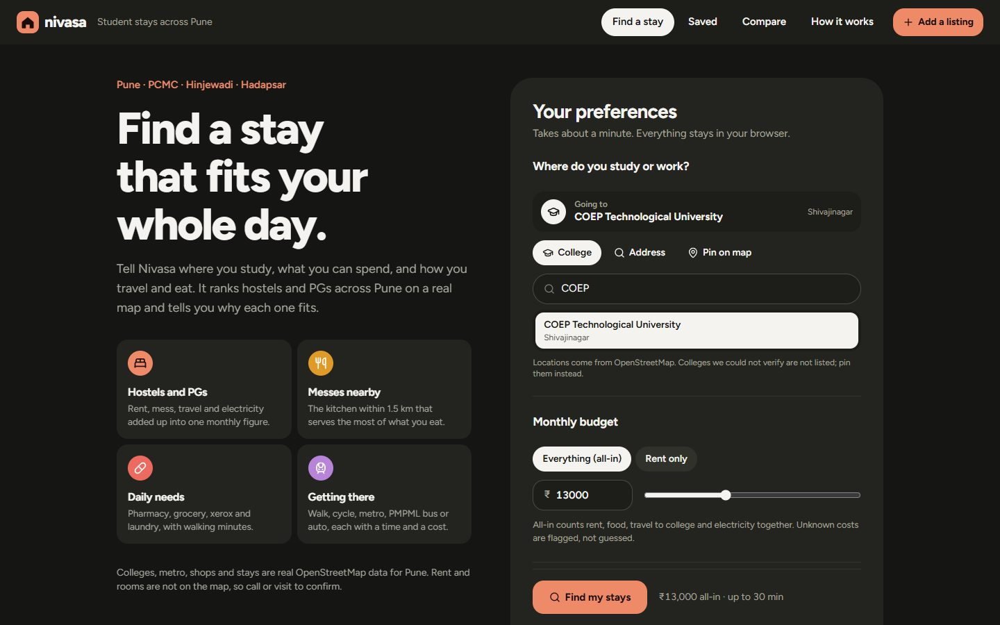<br><b>Preferences.</b> Pick a college (36 with OSM references), an address, or a pin on the map. Budget, travel modes, diet and must-haves take about a minute.</td>
<td width="50%"><br><b>Results.</b> Ranked stays on a map with both metro lines. The best 40 carry score pins and the rest are dots until you zoom in. Each card shows rent, all-in, the trip to college and the nearest kitchen, plus what is unreported.</td>
</tr>
<tr>
<td>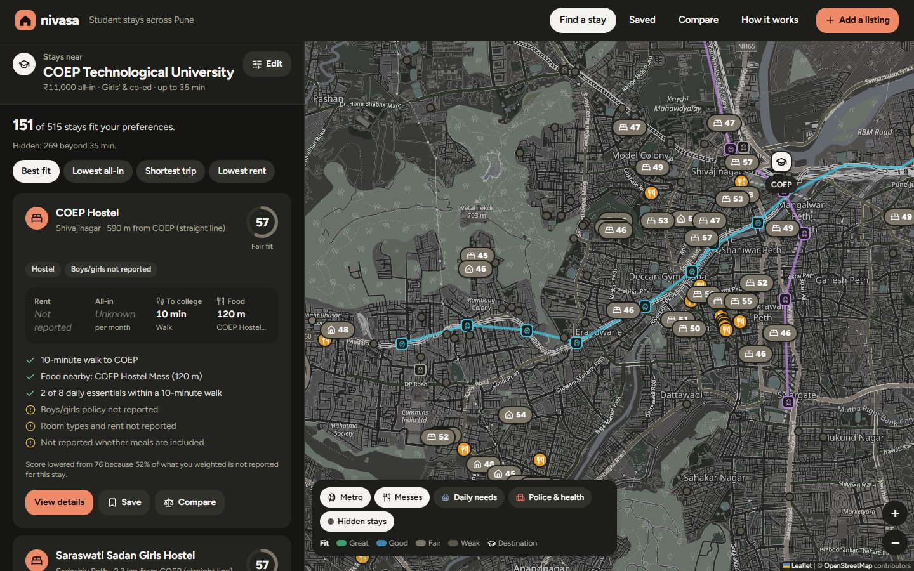<br><b>Gender policy.</b> A girls' search hides boys-only stays. Stays whose policy is not mapped stay in, with a warning.</td>
<td>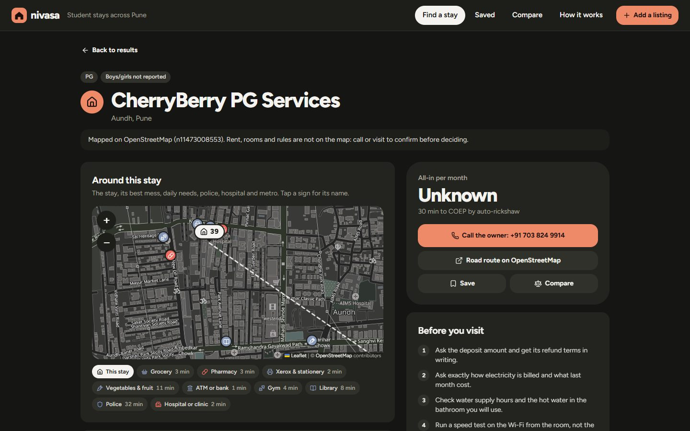<br><b>A stay.</b> Where the record came from, the phone number where one is listed, and the stay's surroundings: messes, essentials, police, hospital and metro.</td>
</tr>
<tr>
<td>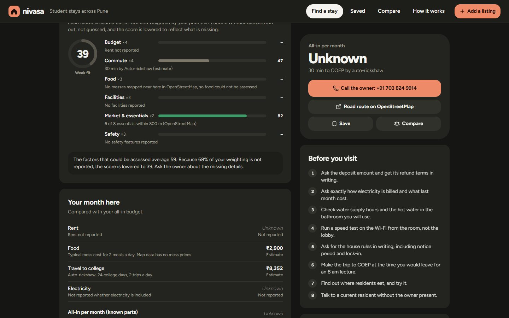<br><b>Score and month.</b> Each factor with its reason, why the score was lowered, and the month's cost line by line, each marked reported, estimate or unknown.</td>
<td>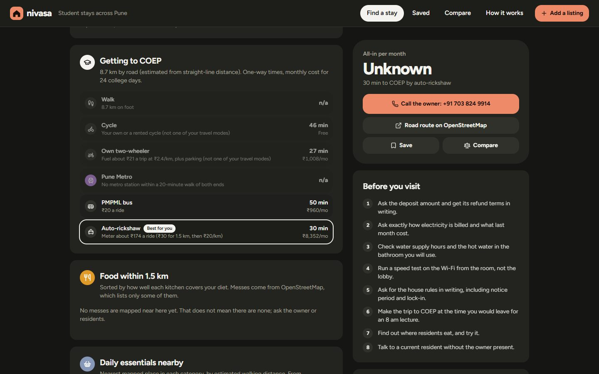<br><b>Getting there.</b> Every travel mode with minutes and monthly cost, and the one recommended.</td>
</tr>
<tr>
<td>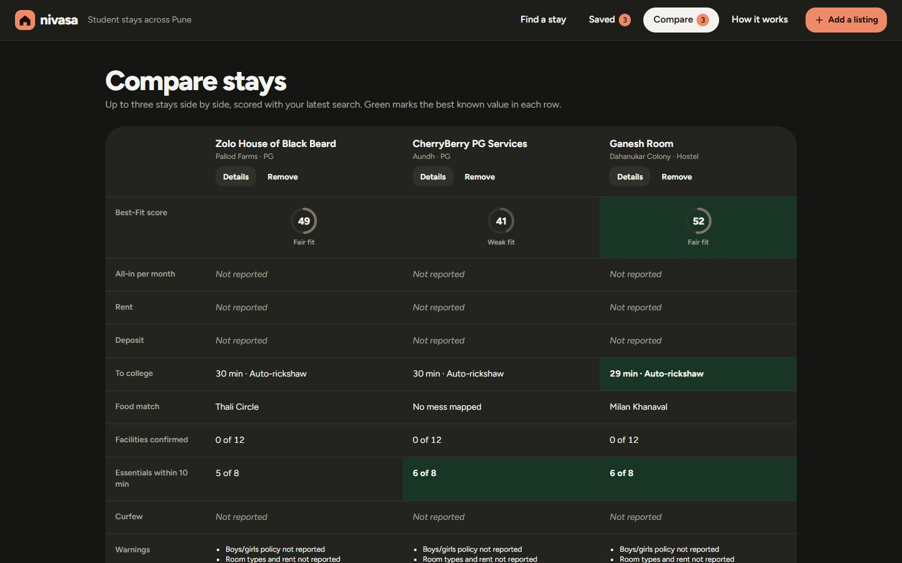<br><b>Compare.</b> Up to three stays side by side, with the best known value in each row marked. On a phone the row labels stay put while the stays scroll.</td>
<td>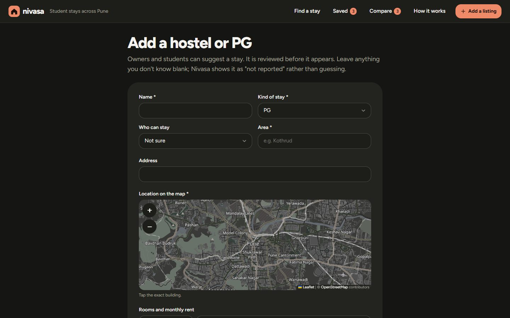<br><b>Add a listing.</b> Owners and students can add rent, rooms and facilities. Submissions stay hidden until an admin approves them.</td>
</tr>
</table>

<p align="center">
  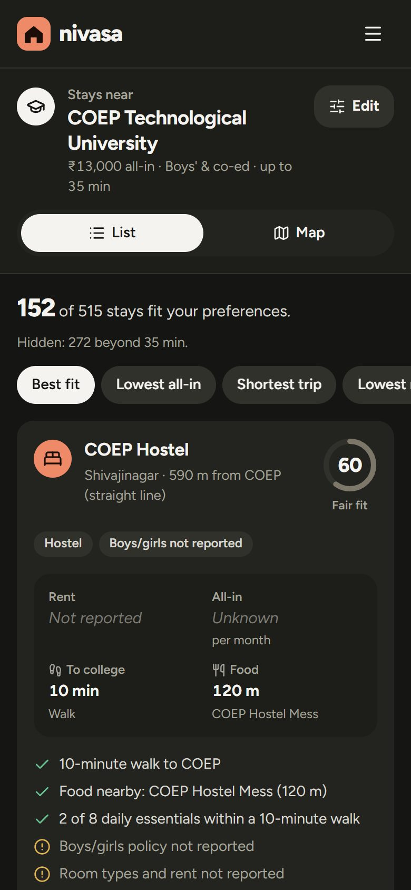
  &nbsp;&nbsp;
  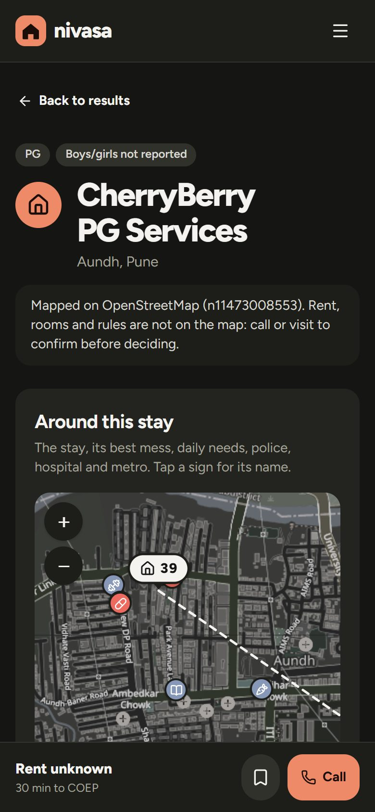
  <br><sub>Built for the phone a student actually searches on: results 25 at a time, a one-row map panel, and Call and Save pinned to the bottom of every stay. Search responses are gzipped (1.2 MB to about 100 KB).</sub>
</p>

## How Nivasa ranks a stay

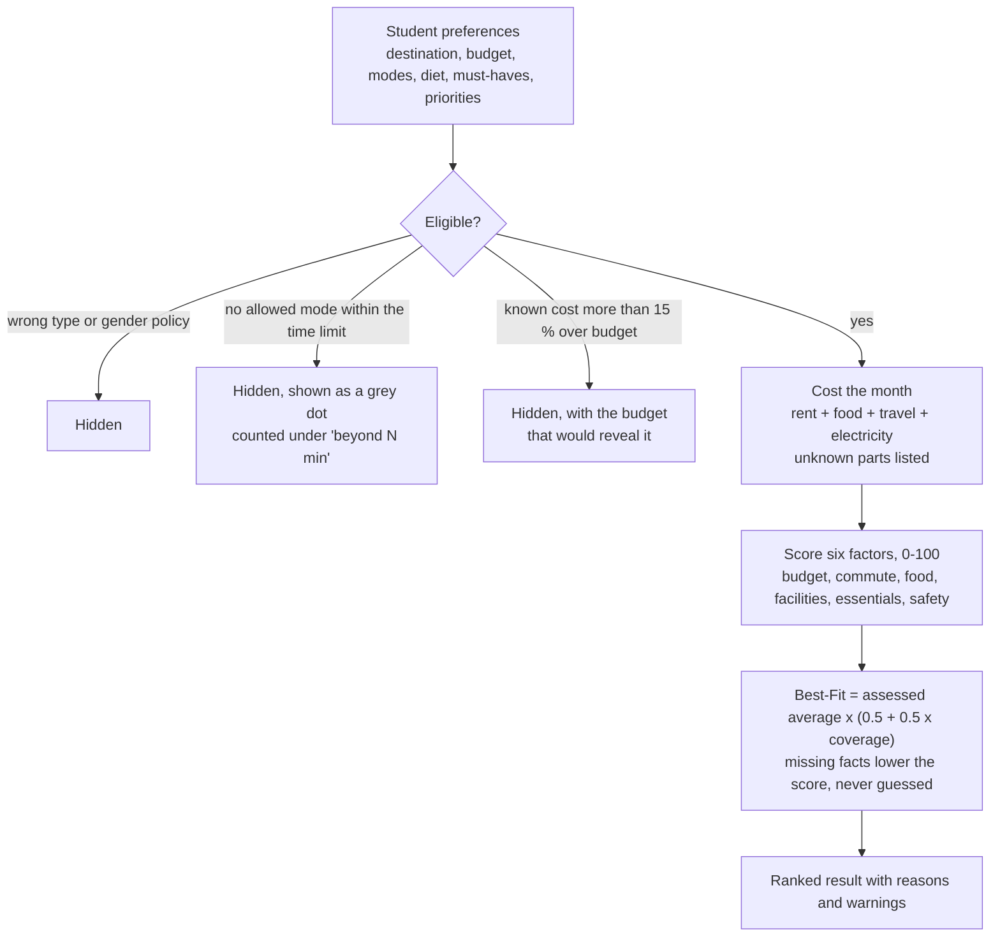

| Factor | From | Unknown when |
|---|---|---|
| Budget | compared amount against the budget | rent not reported |
| Commute | recommended trip time against the student's limit | never |
| Food | best kitchen within 1.5 km: cuisine match and distance | no in-house kitchen and no mess mapped nearby |
| Facilities | confirmed amenities, minus missing must-haves | no amenities reported |
| Essentials | grocery, pharmacy, xerox, vegetables, laundry, ATM, gym, library on OSM | nothing mapped within 1.5 km |
| Safety | reported safety features, plus a police station within 2 km | no safety features reported |

The recommended mode is the allowed mode within the time limit that minimises `minutes + monthly cost ÷ 120`: ₹1,200 a month is treated as worth about ten minutes per trip. The full rules, fares, speeds and their sources are in [docs/METHODOLOGY.md](docs/METHODOLOGY.md).

## Built on real data

| What | Source |
|---|---|
| **Stays from OpenStreetMap (142)** | Hostels, PGs and co-living mapped on **OpenStreetMap**: `tourism=hostel`, `amenity=dormitory`, `building=dormitory`, and places named hostel, PG or co-living. Power-grid lines tagged "(PG)", offices, ruins and unidentifiable names such as "Boys Hostel No. 2" or "L Block" are dropped. |
| **Stays from Overture Maps (373)** | **Overture Maps Places**, which merges places from Meta, Microsoft and others: everything Overture files as `hostel`, plus places named hostel or PG under a lodging category, with confidence 0.5 or more. Hotels, brokers, messes and OYO hotels are dropped. This is where most PGs (Stanza Living, Zolo, OYO Life, independents) and most phone numbers come from. |
| **Merging the two** | One stay, one listing. Records are the same stay when they are within 300 m and share the same phone or most distinctive name words, or carry the same name within 1.5 km. Boys' and girls' blocks are never merged, and call-centre numbers shared by several stays do not count as a match. When a stay is in both, the OSM record is kept and gains Overture's phone (7 did). |
| **Colleges (36)** | OpenStreetMap objects, each with its `osm_ref`. Colleges without a reliable OSM entry are left out; students can pin them on the map. |
| **Pune Metro** | Purple and Aqua line stop order from OSM route relations; 31 open stations, with stations under construction shown but not routed. |
| **Shops, messes, police, hospitals (3,571)** | OSM snapshot of the region, with each place's phone, email, website, address and opening hours where OSM has them. Click any place on a map (or in a listing's nearby lists) for its details card. |
| **Major hospital contacts** | Hand-checked on 2026-10-18 (`backend/app/seed/data/hospital_contacts.json`): Ruby Hall, Jehangir, Deenanath Mangeshkar, KEM, Aditya Birla, Poona Hospital, Manipal, Jupiter from their official sites; Sassoon, Sahyadri, Noble from public directories (labelled as such). |
| **Fares and mess rates** | Pune RTA auto tariff, PMPML fares and passes, Pune Metro fares, SPPU mess rates: see [Sources](#sources). |
| **Map tiles, address search** | OpenStreetMap tiles and Nominatim, both configurable. |

What a stay from these maps **does and does not tell you**:

- **It has** a name, a location, the neighbourhood, and often a phone (345 of 515 stays), sometimes an email (85), a website, or Wi-Fi and AC tags (22).
- **Boys or girls** is read from the name or the advertised tagline only when it says so ("Simran Ladies Hostel", "Unisex PG in Wakad"). 305 stays do not say, and show "Boys/girls policy not reported".
- **It never has** rent, rooms, deposit, meals or house rules. Those show as "Not reported", and the score is lowered to match.
- **55 look like institute hostels** (COEP, Symbiosis, Fergusson, AFMC, Sinhgad ...). They are real, but usually open only to that institute's students, and the listing says so.

Rent and rooms enter through **Add a listing** (`POST /api/submissions`), stay `pending`, and appear after an admin approves them.

## Architecture

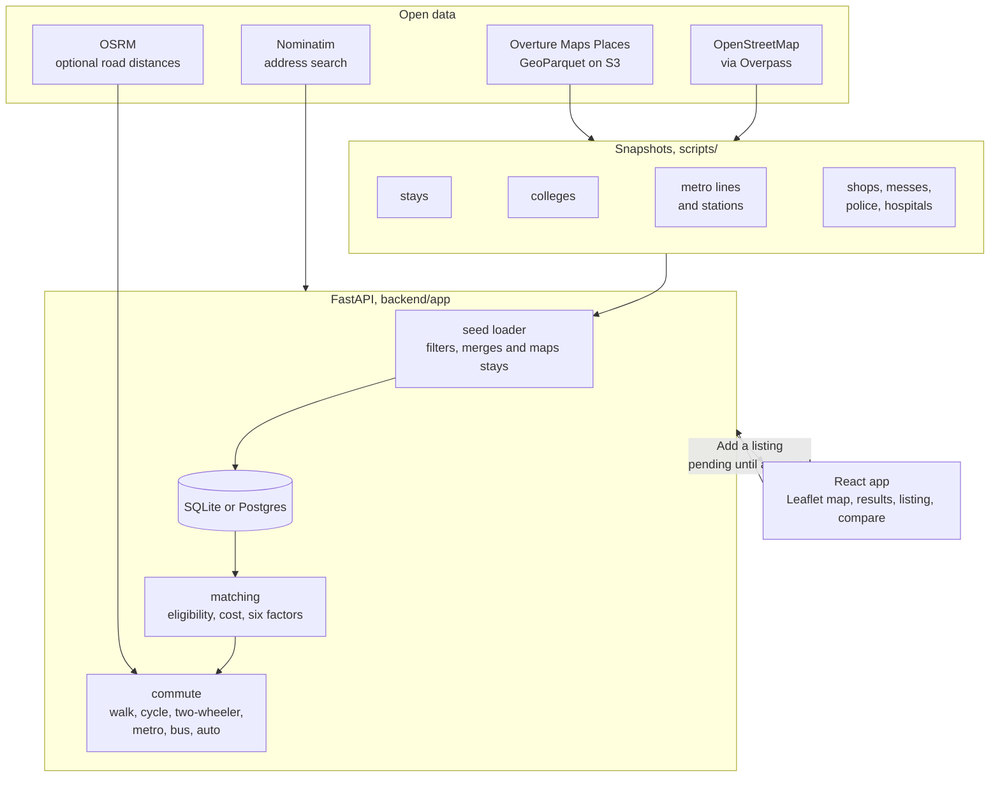

| Layer | Built with |
|---|---|
| Frontend | React 19, TypeScript (strict), Vite 8, Tailwind CSS 4, Leaflet + React Leaflet, React Router, Lucide icons |
| Backend | Python 3.11+, FastAPI, Pydantic 2, SQLAlchemy 2, Alembic |
| Database | SQLite locally, any SQLAlchemy URL (for example Postgres) via `NIVASA_DATABASE_URL` |
| Data | OpenStreetMap through Overpass (stdlib-only script); Overture Maps Places read from S3 with pyarrow |
| Tests | pytest and ruff; Vitest and Testing Library; oxlint |

## What it cannot do yet

- **No rent for real stays.** Neither OpenStreetMap nor Overture carries prices, so the budget factor is unknown for every mapped stay until an owner or student submits it. All-in cost shows the known parts only.
- **Not every PG.** 515 stays is a good start, but many small PGs are on no map at all. Messes (45) and small shops are thinner still.
- **Locations can be off.** Overture positions come from business listings; a few stays sit a short way from the real building. Two listings of the same stay more than 1.5 km apart are both kept, because there is no telling which is right.
- **Gender policy is mostly unknown**, because most names do not state it.
- **Commute times are estimates**, from documented speeds and fares, not live timetables or traffic.
- **No accounts.** Saved stays and comparisons live in the browser.

### Next

- More stays from Foursquare Open Source Places, merged the same way.
- Rent from owner submissions and student reports, with a date on every figure.
- An admin screen for the review queue instead of the API.
- Contributing missing stays and messes back to OpenStreetMap.

## Run it

Requires Python 3.11+ and Node 20+.

```bash
cd backend
python -m venv .venv
.venv/Scripts/activate        # macOS/Linux: source .venv/bin/activate
pip install -r requirements-dev.txt
alembic upgrade head
python -m app.seed
uvicorn app.main:app --reload --port 8000
```

In a second terminal:

```bash
cd frontend
npm install
npm run dev
```

Open <http://127.0.0.1:5173>. API docs are at <http://127.0.0.1:8000/api/docs>. The dev server proxies `/api` to port 8000.

To refresh the map data and reload it:

```bash
python scripts/fetch_osm_data.py            # everything, or name datasets: stays pois stations lines institutions
pip install pyarrow                         # once, for the Overture script
python scripts/fetch_overture_stays.py      # latest Overture release, or pass one such as 2026-10-21.0
cd backend && python -m app.seed            # reference data and mapped stays are replaced; submissions are kept
```

## Reference

<details>
<summary><b>API</b></summary>

| Method | Path | Purpose |
| --- | --- | --- |
| GET | `/api/health`, `/api/meta` | status; labels, defaults and dataset attribution |
| GET | `/api/colleges` | destinations with OSM references |
| GET | `/api/transit` | metro lines and stations |
| GET | `/api/pois?south&west&north&east&categories` | mapped places in a small bounding box |
| GET | `/api/geocode?q=` | colleges by name, then Nominatim within the Pune region |
| POST | `/api/search` | preferences → ranked, explained results plus hidden counts |
| GET | `/api/listings/{id}` | listing facts |
| POST | `/api/listings/{id}/match` | one listing scored against preferences |
| POST | `/api/listings/{id}/reports` | report wrong or outdated information |
| POST | `/api/submissions` | suggest a listing (stored as pending) |
| GET/POST | `/api/admin/submissions[/{id}/approve\|reject]` | review queue; requires `X-Admin-Key` and `NIVASA_ADMIN_API_KEY` |

OSM stays have IDs of the form `osm-n123` or `osm-w456`, after their OpenStreetMap node or way; Overture stays start with `ovt-` and the first 16 characters of their Overture ID.

</details>

<details>
<summary><b>Configuration</b></summary>

See `backend/.env.example` and `frontend/.env.example`. Notable settings:

| Variable | Default | Effect |
|---|---|---|
| `NIVASA_INCLUDE_DEMO_LISTINGS` | `false` | `true` shows the old fictional demo listings, labelled Demo. The tests use them for their full facts. |
| `NIVASA_DATABASE_URL` | SQLite in `backend/` | Any SQLAlchemy URL. |
| `NIVASA_ROUTING_PROVIDER` | `estimate` | `osrm` uses OSRM road distances, falling back to the estimate on failure. |
| `NIVASA_GEOCODER` | `nominatim` | `none` disables address search. Set `NIVASA_NOMINATIM_USER_AGENT` with real contact details before public use. |
| `NIVASA_ADMIN_API_KEY` | none | Enables the admin review routes. |
| `VITE_TILE_URL` | OSM tiles | Point at a production tile provider before launch: OpenStreetMap's own tile servers do not allow heavy traffic. |

</details>

<details>
<summary><b>Checks</b></summary>

```bash
cd backend && python -m pytest && ruff check .
cd frontend && npm run typecheck && npm run lint && npm test && npm run build
```

40 backend tests (matching, commute, transit, the API, the OSM stay loader and the Overture merge) and 13 frontend tests.

</details>

<details>
<summary><b>Deploying</b></summary>

The backend is a standard ASGI app (`uvicorn app.main:app`); run `alembic upgrade head` and `python -m app.seed` on release. The frontend builds to static files in `frontend/dist/`; serve them with any static host, routing unknown paths to `index.html`, and either proxy `/api` to the backend or set `VITE_API_BASE_URL` at build time and add the site to `NIVASA_CORS_ORIGINS`.

</details>

<details>
<summary><b>Project layout</b></summary>

```
backend/
  app/
    api.py              HTTP routes under /api
    models.py           SQLAlchemy models (listings, rooms, OSM places, metro, reports)
    schemas.py          Pydantic request/response models and validation
    services/           geo index, metro network, commute, matching, search, geocoding, routing
    seed/               loader (python -m app.seed), OSM stay filter, data snapshots
  alembic/              migrations
  tests/                pytest suite
frontend/src/
  pages/                search form, results + map, listing, saved, compare, add listing, how it works
  components/           preference form, destination picker, Leaflet map, cards, detail sections
  lib/                  API client, types, URL preferences, local storage
scripts/
  fetch_osm_data.py     refresh the OpenStreetMap snapshot (stdlib only)
  fetch_overture_stays.py  hostels and PGs from Overture Maps Places (needs pyarrow)
  generate_demo_listings.py
docs/
  METHODOLOGY.md        scoring, commute and cost rules with sources
  screenshots/          the images in this README
```

</details>

## Sources

1. SPPU mess rates from 1 October 2026: ₹48 per veg meal for members. Punekar News.
2. Pune RTA auto-rickshaw tariff from 1 September 2026: ₹30 for the first 1.5 km, then ₹20/km. The Bridge Chronicle, Punekar News.
3. PMPML fares and passes from 1 June 2025. Punekar News.
4. Pune Metro fare range and student concession. Housiey guide, Punekar News.

**Data and licences**

- **Stays, colleges, metro, places:** © OpenStreetMap contributors, ODbL 1.0, through the Overpass API.
- **Stays:** © Overture Maps Foundation, CDLA Permissive 2.0, with places from Meta and Microsoft. <https://docs.overturemaps.org/attribution/>
- **Address search:** Nominatim, under its usage policy.
- **Map tiles:** OpenStreetMap contributors, through Leaflet.

<p align="center"><br><sub><b>Nivasa</b> · Know what a month really costs before you sign for the room.</sub></p>
